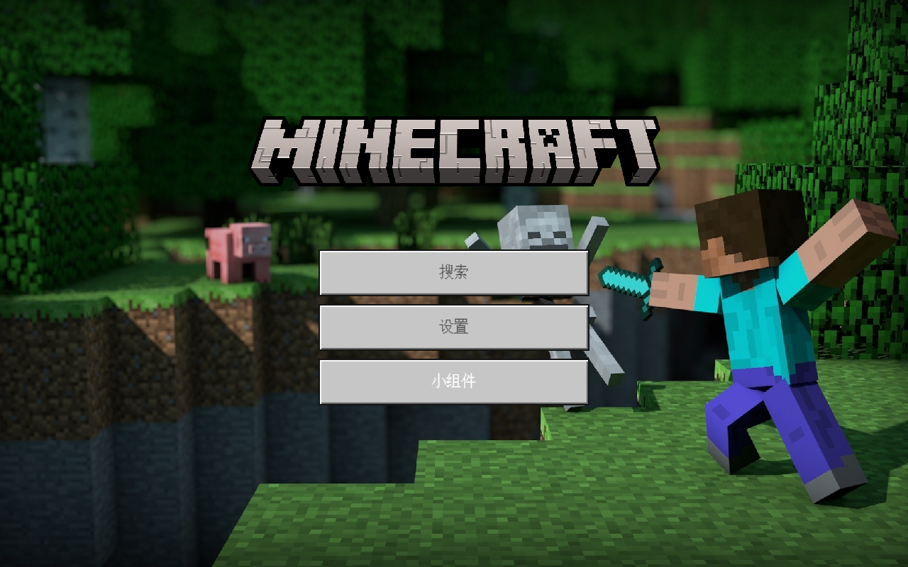

# CraftTab

**English | [简体中文](README.zh-CN.md)**

A Minecraft Bedrock-style new tab page for Edge and Chrome. Manifest V3, plain HTML/CSS/JS, no build step required.

Current version: **1.0.1** — see [release notes](docs/release-notes-v1.0.1.md).



## What it does

- **Bedrock-style main menu** — pixelated Search / Settings / Widgets buttons, editable player name.
- **Wallpapers** — built-in image, local images, and video wallpapers with volume and a sound toggle. Audio pauses when the tab is hidden or closed, and only one tab makes sound at a time.
- **Search** — Bing, Google, Baidu, DuckDuckGo, Yandex and 360, with local search history.
- **Widget inventory** — 17-column grid, category tabs, a separate hotbar, drag to add or remove, custom icons.
- **Icon fetching** — pulls favicon / web-manifest icons, validates their size, and falls back to manual upload.
- **Resource packs** — import `.mcpack` or `.zip` files to override UI textures, fonts and texts; enable, disable, reorder or delete them, applied instantly.
- **Settings** — General, Wallpaper, Language, Global Resources, Widgets, Reset & Backup, About. Export / import backups.
- **Eight languages** — English, 简体中文, 繁體中文, 日本語, 한국어, Español, Русский, Français.

## Install

### Load unpacked (recommended)

1. Download the latest `MCNewTab-*.zip` from Releases and extract it.
2. Open `edge://extensions` or `chrome://extensions` and turn on **Developer mode**.
3. Click **Load unpacked** and choose the extracted folder.
4. Open a new tab — CraftTab is there.

### Signed `.crx`

Drag the `.crx` into the extensions page. Some browsers restrict non-store CRX installs; if that happens, use the unpacked zip instead.

## Resource packs (`.mcpack` / `.zip`)

A `.mcpack` is a Minecraft Bedrock resource pack, i.e. a zip with the `.mcpack` extension. Import it in **Settings → Global Resources**; the pack list puts higher entries above lower ones, with the built-in `Default` pack at the bottom. Plain `.zip` archives with the same layout are also accepted.

```
manifest.json      # pack header (pack.json is also accepted)
pack_icon.png
textures/ui/*.png     # UI textures, e.g. title.png, toggle_on.png, indent.png
font/main.ttf         # optional: replace the interface font
texts/zh_CN.lang      # optional: key=value overrides, only the keys you list
ui/theme.json         # optional: CSS variables beginning with --
```

Minimal `manifest.json`:

```json
{
  "format_version": 1,
  "header": {
    "name": "My Pack",
    "description": "Recolors the main menu logo",
    "version": [1, 0, 0],
    "uuid": "2b7d9c10-6f2e-4b5a-9c31-8d7e6f5a4b3c",
    "author": "43086FG"
  }
}
```

Rules:

- The pack header may be named `manifest.json` or `pack.json`; `pack.json` wins if both exist.
- The built-in `Default` pack ships as `pack.json` so the extension package keeps a single root `manifest.json`.
- `header.name`, `header.uuid` and `header.version` are required. Re-importing the same `uuid` replaces the old pack.
- Only files inside the pack are overridden; everything else keeps using `Default`.
- `texts/*.lang` is merged key by key, not replaced wholesale.
- Textures match by logical file name — `textures/ui/title.png` changes the main menu logo.
- The full list of overridable textures is in [`src/packs/README.md`](src/packs/README.md).

## Project layout

```
src/                  extension source — load this folder directly
  manifest.json
  newtab.html
  settings.html
  background.js       icon fetching service worker
  css/ js/
  assets/             textures, font, default wallpaper
  icons/              extension icons
  texts/              eight .lang files
  packs/default/      built-in Default resource pack
  packs/README.md     resource pack reference
docs/                 screenshots used by the READMEs
build/build.ps1       packaging script
README.md             English
README.zh-CN.md       简体中文
```

## Build

```powershell
powershell -ExecutionPolicy Bypass -File build/build.ps1
```

The script copies `src/` to `dist/MCNewTab/`, prunes textures that are not referenced, and writes `dist/MCNewTab.zip`. To sign a CRX3 package:

```powershell
npx crx3 -p privatekey.pem -o dist/MCNewTab.crx dist/MCNewTab
```

Keep the `.pem` private key locally — it is ignored by git, and future CRX updates must reuse the same key.

## Languages

Interface strings live in `src/texts/*.lang` as `key=value`. To add a language, copy `en_US.lang`, translate the values, and register the locale in `src/js/i18n.js`. Language can be switched in settings and applies to both the new tab and settings pages without a reload.

## Privacy

Everything stays on your device: settings, search history, widgets, wallpapers and resource packs are stored in `chrome.storage.local` or IndexedDB. Nothing is uploaded and there is no analytics or telemetry. Icon fetching only happens when you use it, and requests go directly from your browser to the target site or a public favicon service (Google s2, DuckDuckGo). Uninstalling the extension or clearing its data removes everything. See the full [Privacy Policy](docs/privacy-policy.md).

## Author

43086FG · fg43086@outlook.com

## License & assets

Code is released under the [MIT License](LICENSE), Copyright (c) 2026 43086FG.

CraftTab is an unofficial fan project, not affiliated with Mojang or Microsoft. Minecraft and related assets are the property of Mojang Studios / Microsoft. Please own a legitimate copy of Minecraft and do not use these assets commercially.
