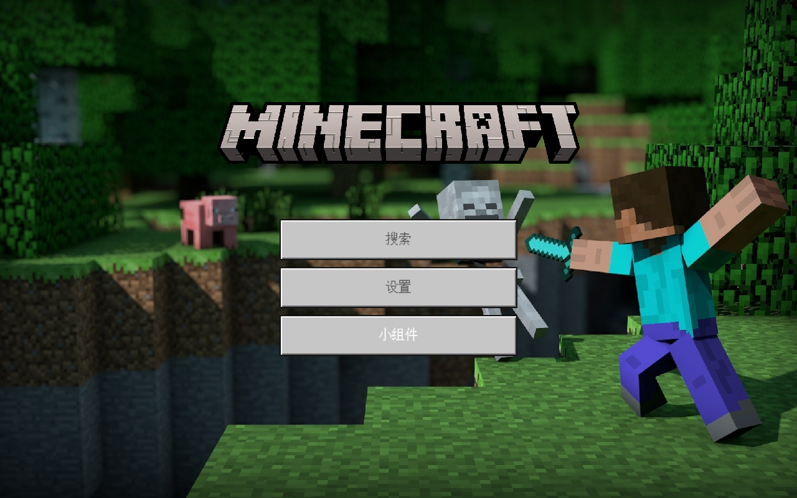

# CraftTab

**[English](README.md) | 简体中文**

Minecraft 基岩版风格的 Edge / Chrome 新标签页扩展。Manifest V3，原生 HTML/CSS/JS，无需构建即可加载。



## 功能

- **基岩版风格主菜单** —— 像素化「搜索 / 设置 / 小组件」按钮，玩家名可编辑。
- **壁纸** —— 内置壁纸、本地图片与视频壁纸，支持音量滑杆和声音开关；切到其他标签或关闭页面会停播静音，多标签页同时打开时只有一路声音。
- **搜索** —— Bing、Google、Baidu、DuckDuckGo、Yandex、360 六种引擎，搜索历史保存在本地。
- **小组件物品栏** —— 17 列网格、分类页签、独立快捷栏，拖拽增删、自定义图标。
- **图标抓取** —— 自动查找 favicon / manifest 图标并校验尺寸，抓不到时可手动上传。
- **资源包** —— 导入 `.kzpack` 替换界面贴图、字体与文案，可启用 / 停用 / 排序 / 删除，导入立即生效。
- **设置页** —— 常规设置、壁纸、语言、全局资源、小组件、重置与备份、关于，支持导出 / 导入备份。
- **八种语言** —— 简体中文、繁體中文、English、日本語、한국어、Español、Русский、Français。

## 安装

### 加载解压缩（推荐）

1. 从 Releases 下载最新的 `MCNewTab-*.zip` 并解压。
2. 打开 `edge://extensions` 或 `chrome://extensions`，开启「开发人员模式」。
3. 点「加载解压缩的扩展」，选择解压后的目录。
4. 新开一个标签页即可看到 CraftTab。

### 签名 `.crx`

把 `.crx` 拖入扩展管理页即可。部分浏览器会限制非商店来源的 CRX，若被拦截请改用 zip 方式。

## 资源包（`.kzpack`）

`.kzpack` 就是把 zip 改后缀。在 **设置 → 全局资源** 中导入；列表位置越靠上优先级越高，最下面是内置 `Default` 包。

```
manifest.json         包元信息（也可命名为 pack.json）
pack_icon.png
textures/ui/*.png     可覆盖的 UI 贴图，如 title.png、toggle_on.png、indent.png
font/main.ttf         可选：替换界面字体
texts/zh_CN.lang      可选：key=value 增量覆盖，只写需要改的行
ui/theme.json         可选：以 -- 开头的 CSS 变量
```

最小 `manifest.json`：

```json
{
  "format_version": 1,
  "header": {
    "name": "我的资源包",
    "description": "把主菜单 LOGO 换个颜色",
    "version": [1, 0, 0],
    "uuid": "2b7d9c10-6f2e-4b5a-9c31-8d7e6f5a4b3c",
    "author": "43086FG"
  }
}
```

规则：

- 包清单可命名为 `manifest.json` 或 `pack.json`，两者同时存在时优先 `pack.json`。
- 内置 `Default` 包使用 `pack.json`，确保扩展包根目录只有一个 `manifest.json`。
- `header.name`、`header.uuid`、`header.version` 必填；相同 `uuid` 重新导入会覆盖旧包。
- 只覆盖包内实际存在的文件，其余继续使用 `Default`。
- `texts/*.lang` 按 key 合并，不会清空未写的键。
- 贴图按逻辑文件名匹配，例如 `textures/ui/title.png` 会替换主界面 LOGO。
- 完整可覆盖贴图清单见 [`src/packs/README.md`](src/packs/README.md)。

## 目录结构

```
src/                  扩展源码，可直接加载
  manifest.json
  newtab.html
  settings.html
  background.js       图标抓取 service worker
  css/ js/
  assets/             贴图、字体、默认壁纸
  icons/              扩展图标
  texts/              八种语言的 .lang
  packs/default/      内置 Default 资源包
  packs/README.md     资源包规范
docs/                 README 使用的截图
build/build.ps1       打包脚本
README.md             英文
README.zh-CN.md       简体中文
```

## 构建

```powershell
powershell -ExecutionPolicy Bypass -File build/build.ps1
```

脚本会把 `src/` 复制到 `dist/MCNewTab/`，裁剪未被引用的贴图，并生成 `dist/MCNewTab.zip`。如需签名 CRX3：

```powershell
npx crx3 -p privatekey.pem -o dist/MCNewTab.crx dist/MCNewTab
```

`.pem` 私钥只保存在本地（已被 git 忽略），后续升级 CRX 必须复用同一把钥匙。

## 多语言

界面文案位于 `src/texts/*.lang`，格式为 `key=value`。新增语言时复制 `en_US.lang` 翻译值，并在 `src/js/i18n.js` 注册语言代码。设置页切换语言后，新标签页与设置页都会即时更新，无需刷新。

## 隐私

所有数据都在本机：设置、搜索历史、小组件、壁纸与资源包保存在 `chrome.storage.local` 或 IndexedDB，不上传任何数据，也不含统计或遥测。图标抓取只在你使用时发生，请求由浏览器直接发往目标网站或公共 favicon 服务（Google s2、DuckDuckGo）。卸载扩展或清除扩展数据即可删除全部内容。

## 作者

43086FG · fg43086@outlook.com

## 许可与素材版权

代码以 [MIT License](LICENSE) 发布，Copyright (c) 2026 43086FG。

CraftTab 是非官方个人作品，与 Mojang / Microsoft 无关联。Minecraft 及相关素材版权归 Mojang Studios / Microsoft 所有；使用前请确认拥有正版游戏授权，请勿将素材用于商业用途。
